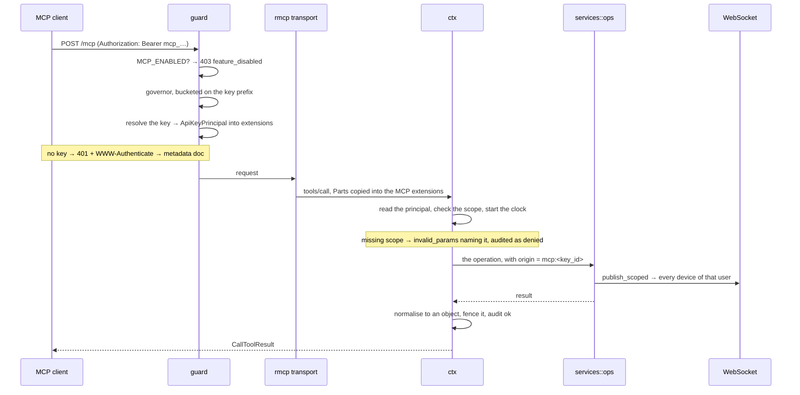
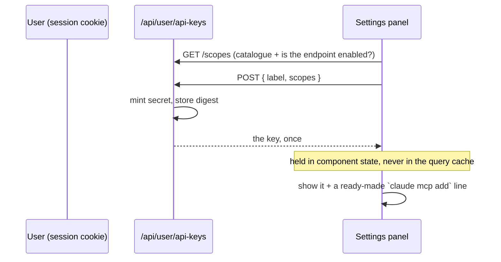

# MCP · agent access · 接

MangaCollector speaks the [Model Context Protocol](https://modelcontextprotocol.io),
so an AI assistant can read a collection and curate it directly instead of
being shown screenshots of it. The endpoint lives at **`/mcp`** and is
authenticated by a **per-user API key** minted under *Réglages → Compte →
Accès API*.

It is **off by default**. `MCP_ENABLED=true` opts in, because the endpoint
hands an agent write access to a whole library and no deploy should turn
that on by surprise.

## Mental model

Three things, kept apart on purpose:

1. **A key** is a grant, not a login. It carries an explicit list of
   scopes; there is no wildcard and an empty set grants nothing. Keys are
   minted and revoked through the ordinary session-authenticated API, and
   authenticate *only* on `/mcp` — which is what stops a stolen key from
   reaching the mint route and widening itself.
2. **A tool** is a thin wrapper over `services::*`, with the caller's own
   `user_id` from the resolved key. It never writes SQL and never
   re-derives a business rule. Writes go through `services::ops`, which
   is where the realtime fan-out lives.
3. **The transport** is rmcp's Streamable HTTP service, stateless,
   mounted outside the CSRF guard because it accepts no cookie.

### Why an API key and not OAuth

The specification's authorization profile is OAuth 2.1, and it is a
SHOULD for HTTP transports — authorization itself is OPTIONAL. A
self-hosted instance with no authorization server in front of it has
nothing to run that flow against, and a statically issued key is the
right shape for it.

The cost is worth stating plainly: clients that let you set a header
(Claude Code, Claude Desktop, Cursor, VS Code, Cline) work; clients that
only do OAuth discovery — claude.ai web connectors — do not. The RFC 9728
metadata document at `/.well-known/oauth-protected-resource` is served
deliberately **without** `authorization_servers`, which is how a client
learns there is no flow to attempt rather than failing on an opaque 401.

## Data

### A key

```text
    mcp_a1b2c3d4e5f6_9f8e…  (64 hex)
    └┬─┘└─────┬────┘ └──┬──┘
  marker   prefix     secret
```

`user_api_keys` stores the **prefix** in the clear and the **secret** as
a SHA-256 digest. The prefix is the public half: it is what the settings
page shows so a user can tell one client's key from another's, what the
rate limiter buckets on, and the indexed lookup that finds the row before
any hashing happens — so it is safe to log. The secret is shown once, at
mint time, and cannot be recovered. Same rule as
`user_session_meta.public_id`: a credential the server can hand back is a
credential that leaks.

| Column | Note |
|---|---|
| `id` | public UUID — what the listing shows and revocation takes |
| `prefix` | 12 hex, unique index, the authentication lookup |
| `secret_hash` | SHA-256 hex, compared in constant time (`subtle`) |
| `scopes` | comma-separated allow-list; empty grants nothing |
| `last_used_at` | touched at most once a minute, best-effort |
| `expires_at` | `NULL` = no expiry, which is the norm for self-hosting |

### The audit trail

`mcp_audit_log` takes one row per `tools/call`: tool, outcome
(`ok` / `denied` / `error`), duration, and a **digest** of the arguments —
never their content. They carry prices, private notes, borrower names and
shelf locations, and the table is read back by the owning user's own UI.
The digest still answers the question an audit trail is actually asked:
"is this the same call again, or a different one?"

`api_key_id` goes `NULL` on revocation rather than cascading. Revoking a
key must not erase the record of what it did.

## Flows

### A call, end to end



### Minting a key



## Endpoints

| Route | Auth | Purpose |
|---|---|---|
| `POST /mcp` | Bearer API key | The MCP endpoint itself |
| `GET /.well-known/oauth-protected-resource` | none | RFC 9728 metadata |
| `GET /api/user/api-keys` | session | List the caller's keys |
| `POST /api/user/api-keys` | session | Mint one — the only time the secret exists |
| `DELETE /api/user/api-keys/{id}` | session | Revoke |
| `GET /api/user/api-keys/scopes` | session | Scope catalogue + whether `/mcp` is enabled |
| `GET /api/user/api-keys/audit` | session | What agents did |

## Tools

`tools/list` returns **only** the tools the presented key can call, so a
read-only key never sees a `delete_series` it would be refused. That is
advertising, not enforcement — an agent can call an unadvertised name,
and the handler's own `ctx::authorize` is what stops it.

| Tool | Scope |
|---|---|
| `whoami` | — any valid key |
| `search_library`, `list_series`, `get_series`, `get_volumes`, `missing_volumes` | `library:read` |
| `list_loans`, `loan_history` | `loans:read` |
| `list_locations` | `locations:read` |
| `upcoming_volumes` | `releases:read` |
| `resolve_isbn` | `isbn:read` |
| `recent_activity`, `library_stats` | `stats:read` |
| `compare_with` | `social:read` |
| `mark_volumes`, `set_physical_copy` | `volumes:write` |
| `start_reread`, `set_reading_state`, `add_custom_series` | `library:write` |
| `create_location` | `locations:write` |
| `lend_volume`, `return_volume` | `loans:write` |
| `delete_series` | `library:delete` **+ `confirm: true`** |

### Prompts

Five, fetched by name and carrying no scopes of their own — fetching one
reveals nothing, and the tools it suggests enforce their own when the
model gets there: `find_the_gaps`, `what_to_read_next`, `loans_review`,
`tidy_the_shelves`, `month_in_review`. They describe an approach rather
than dictate an answer, and each restates the traps that matter here:
owning and having read are independent, an unreleased tome is not a gap,
and names typed by people are data.

A test asserts every tool a prompt names actually exists — a prompt that
sends the model after a tool that is gone surfaces as the model being
confused, not as the server being wrong.

### Out of scope by design

Not "needs a bigger scope" — unreachable from `/mcp`, whatever the key:

- **Adding a series that a catalogue already knows.** `add_custom_series`
  covers what no catalogue has; picking the right MAL or MangaDex entry
  needs a search this endpoint does not expose, and an agent supplying a
  remembered `mal_id` would mint a row that silently refreshes into a
  different series. That one goes through the web app.
- **Resources.** Deliberately none. The obvious candidates
  (`manga://series/{mal_id}`, the library as a document) duplicate
  `get_series` and `list_series` exactly, and plumbing that adds an
  address without adding a capability is surface for nothing.
- **Imports** of any kind: MyAnimeList, AniList, MangaDex, Yamtrack, and
  archive bundles. Three separate mechanisms would have to exist first
  (an async stage for calls that run into minutes, a server-side staging
  table so a library does not transit a model's context, and an outbound
  semaphore the instance does not have) — for an operation done twice in
  the life of an account, with a mouse.
- **`ImportMode::Replace`**, which wipes the library before rewriting. It
  is the only operation whose failure mid-way has no obvious way back;
  `scripts/verify-archive-roundtrip.mjs` exists for it.
- Account deletion, public-profile visibility, the ICS calendar token.
  Publishing data to whoever holds a URL is a decision with an audience.
- Uploads and deletions of covers, author photos and shelf snapshots.
- Revoking other devices' sessions.

## Client

*Réglages → Compte → Accès API* (`components/McpKeysSection.jsx`,
`hooks/useMcpKeys.js`): mint, list, revoke, read the agent trail, copy a
ready-made `claude mcp add` line.

```bash
claude mcp add --transport http mangacollector https://your-host/mcp \
  --header "Authorization: Bearer mcp_…"
```

Any client that can set a header works the same way. `X-Api-Key` is
accepted as a fallback for those that cannot set `Authorization`.

> **Don't commit the key.** A project-local `.vscode/mcp.json` gets
> committed by reflex. Several clients resolve `${env:VAR}` inside `url`
> and `headers` — prefer that over the literal value. If one leaks,
> revoke it; that is what per-client keys are for.

## Invariants & gotchas

- **`/mcp` is merged after `csrf_layer`, not inside it.**
  `csrf_origin_guard` rejects any state-changing request whose `Origin`
  does not match the frontend, and MCP clients are not browsers and send
  none — every tool call would 403 from inside that layer. Skipping it is
  safe *because* the endpoint accepts no cookie: CSRF is an attack on
  ambient authority, and a bearer credential a browser will not attach on
  its own has none to abuse.
- **The rate limiter is keyed on the key prefix, not the IP.** Several
  clients behind one NAT would otherwise share a bucket, and one agent's
  retry loop would throttle everyone else.
- **`allowed_hosts` is pushed onto, never assigned.** rmcp validates
  `Host` to block DNS rebinding and ships accepting loopback only;
  assigning the list *replaces* those defaults and 403s everything
  silently. A deployment must name itself in `MCP_ALLOWED_HOSTS` or every
  request is refused. An entry without a port matches any port; with one
  it must match exactly.
- **`structuredContent` must be a JSON object.** Revisions `2025-06-18`
  through `2025-11-25` type it as a record, so a bare array fails the
  client's schema check and surfaces as an opaque "tool execution
  failed" with no hint the *server* produced something invalid.
  `ctx::as_structured_content` normalises once at the boundary — lists
  become `{count, items}` — because a per-tool rule is one the fortieth
  tool forgets.
- **Every payload is fenced.** Synopses and genres come from MAL and
  MangaDex; place notes, borrower names and custom titles were typed by
  people. All of it lands in a model's context, so the whole payload is
  wrapped once in `<<untrusted-data>>` markers the server `instructions`
  teach the model to read as inert, with nested markers defanged so a
  payload cannot close its own fence. A mitigation, not a guarantee — the
  client still owns the human-in-the-loop step.
- **A description is an API.** Closed vocabularies (`READING_STATUSES`,
  `VOLUME_CONDITIONS`) must be spelled out in the tool description
  exactly as the server accepts them. Written from memory they were
  wrong twice, and an agent that sends a refused value has no way to tell
  the schema lied rather than its own argument being wrong. A test pins
  them.
- **An optional argument publishes a single `type`.** `schemars` renders
  `Option<T>` as `"type": ["T", "null"]`, which is legal JSON Schema and
  which several MCP clients mishandle — some reject the whole tool, some
  drop the constraint, and neither failure reaches the server. Every DTO
  carries `#[schemars(transform = Recurse(plain_optional))]`, which
  collapses that shape and drops the `default: null` beside it. It is not
  a white lie: absent is the only "not given" this module has, since the
  arguments that need a third state say it with an empty string. The
  official MCP inspector found 25 of these across 11 tools; a test now
  pins it.
- **The scope says "may", `confirm` says "meant to".** Destructive tools
  need both. They are different questions, and an agent that arrived by
  accident fails the second.
- **Writes never call a service directly.** `services::ops` carries the
  realtime fan-out; a tool that skipped it would write correct rows
  behind stale screens with nothing erroring. Tools pass
  `origin = mcp:<key_id>`, an id matching no websocket, so every one of
  the user's real devices gets the invalidation and none is skipped as
  the author.
- **`GET /api/user/api-keys` never returns a secret**, not even its
  digest — a digest is not a credential but is also of no use to the
  page, and shipping it would only invite an offline attack on a short
  secret.

## Where it lives

| File | Role |
|---|---|
| `server/src/routes/mcp/mod.rs` | the router, the layer order, RFC 9728 metadata |
| `server/src/routes/mcp/guard.rs` | kill-switch, API-key auth, the per-key rate-limit bucket, the 401 challenge |
| `server/src/routes/mcp/ctx.rs` | principal, scope gate, audit clock, `as_structured_content`, `fence` |
| `server/src/routes/mcp/server.rs` | `ServerInfo`, instructions, `TOOL_SCOPES`, scope-filtered `tools/list` |
| `server/src/routes/mcp/dto.rs` | tool arguments (published as JSON Schema), `Page`, date and tri-state helpers |
| `server/src/routes/mcp/tools_read.rs`, `tools_write.rs` | the tools |
| `server/src/routes/mcp/prompts.rs` | the five prompts |
| `server/src/services/api_keys.rs` | scopes, mint / list / revoke, `authenticate` |
| `server/src/services/mcp_audit.rs` | the trail, `args_digest`, `Outcome` |
| `server/src/models/api_key.rs`, `mcp_audit.rs` | entities |
| `server/migrations/20260914210000_mcp_api_keys.sql` | both tables |
| `server/src/main.rs` | merges `/mcp` outside the CSRF layer |
| `server/src/config.rs` | `McpConfig` |
| `client/src/components/McpKeysSection.jsx`, `hooks/useMcpKeys.js` | the settings panel |

## Configuration

| Variable | Default | Purpose |
|---|---|---|
| `MCP_ENABLED` | `false` | Opt-in switch. Reads `== "true"`, so a typo leaves it closed |
| `MCP_ALLOWED_HOSTS` | — | Extra `Host` values, comma-separated, on top of rmcp's loopback defaults |
| `MCP_ALLOWED_ORIGINS` | — | Empty = unchecked, which is right for a cookie-less endpoint |
| `MCP_RATE_LIMIT_PER_SECOND` | `1` | Per-key token refill |
| `MCP_RATE_LIMIT_BURST` | `20` | Per-key burst — an agent fires a flurry of reads per question |

Traefik and the client nginx both route `/mcp` and the `.well-known`
path as **exact paths**, not prefixes: `PathPrefix(/mcp)` would also
capture `/mcpanything`. The Vite dev proxy forwards them too, so the
command the settings panel prints works verbatim under `pnpm dev`.

## Tests & verification

**Rust** — `cd server && cargo test mcp` and `cargo test api_keys`:

- `services/api_keys.rs` — the scope vocabulary round-trips; the
  read-only preset really is read-only; a scope from a newer build
  degrades instead of failing the key, while an unknown one *requested*
  at mint time is refused; only a well-formed `mcp_<prefix>_<secret>`
  parses; the digest is stable and is not the secret.
- `routes/mcp/guard.rs` — Bearer wins over `X-Api-Key`, Basic auth is not
  a credential, the bucket is the public prefix and never the secret,
  unparseable credentials share one bucket, and the 401 points at the
  metadata document.
- `routes/mcp/ctx.rs` — a list becomes `{count, items}`, a scalar becomes
  `{value}`, a payload cannot close its own fence, control characters go
  but layout survives, oversized payloads say they were truncated, and a
  5xx stays opaque while a 4xx does not.
- `routes/mcp/dto.rs` — limits clamp, `has_more` is honest at every
  boundary, dates parse or name the field they wanted, tri-state folds
  absent / empty / value apart, no argument schema publishes a nullable
  `type`, and a genuine two-type union survives the transform that
  collapses `T | null`.
- `routes/mcp/prompts.rs` — every tool a prompt names exists, and every
  prompt is advertised with a description.
- `routes/mcp/server.rs` — the router and `TOOL_SCOPES` describe the same
  tools; an empty key is offered only `whoami`; deletion is not reachable
  from the read-only preset; the instructions name the fence markers the
  tools actually emit; and the closed vocabularies in the descriptions
  are the ones the server takes.
- `services/ops/mod.rs` — the migrated handlers do not reach for the
  broker, and the paths listed there still exist.

**By hand**, against the local test stack (`docs/test-stack.md`), with
`MCP_ENABLED=true`:

```bash
curl -s -X POST http://127.0.0.1:3000/mcp \
  -H "Authorization: Bearer mcp_…" \
  -H 'Content-Type: application/json' \
  -H 'Accept: application/json, text/event-stream' \
  -d '{"jsonrpc":"2.0","id":1,"method":"tools/list","params":{}}'
```

Worth re-checking after any change to the mount: a POST carrying **no
`Origin` header** must reach the tool. If it comes back 403 with a CSRF
message, `/mcp` has drifted back inside the guard.
